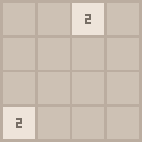

# 2048-ai

A reinforcement-learning agent that learns to play 2048, built on a custom [Gymnasium](https://gymnasium.farama.org/)
environment and [MaskablePPO](https://sb3-contrib.readthedocs.io/en/master/modules/ppo_mask.html) from sb3-contrib.

<p align="center">
  
</p>

*The final model (5M training steps) playing its best of 200 games: 32,992 points, reaching 2048 in 1,714 moves.*

| Agent (500 games, seeds 10,000–10,499) | Mean score | Reaches 512 | Reaches 1024 | Reaches 2048 |
|---|---|---|---|---|
| **PPO, CNN, 5M steps (final)** | **13,569** | **93.8%** | **63.0%** | **8.2%** |
| PPO, MLP, 1M steps | 3,733 | 27.4% | 0.8% | 0% |
| `corner` heuristic (down > left > right > up) | 2,600 | 5.6% | 0% | 0% |

## Quick start

```bash
uv sync
uv run pytest                                  # 42 tests: game rules, Gymnasium API, agents, replays
uv run play-2048                               # play it yourself (w/a/s/d)
uv run eval-2048 --agent corner --episodes 500 --seed 10000
uv run python -u scripts/train_ppo.py          # train 5M steps from scratch (~2.6 h on a laptop CPU)
uv run eval-2048 --agent ppo --model checkpoints/ppo_cnn64_norm/final.zip --episodes 500 --seed 10000
uv run replay-2048 --model checkpoints/ppo_cnn64_norm/final.zip --best-of 200 --open
```

Checkpoints aren't committed (`checkpoints/` is git-ignored), so train a model before evaluating or replaying it.

---

## How the final model was reached

All numbers below come from the same evaluation: 500 games on seeds 10,000–10,499, which no model trained on, with
deterministic play (the most likely legal move) unless noted.

### 1. The environment

`Game2048-v0` (in [src/game2048/](src/game2048/)) is a Gymnasium environment on top of a framework-free game engine:

- **Observation:** the 4×4 board as tile exponents (`0` empty, `1` = 2, … `11` = 2048).
- **Actions:** up, right, down, left. `info["action_mask"]` and `env.action_masks()` give the legal moves, so the
  agent never wastes a step on a move that doesn't change the board.
- **Reward:** configurable (see [Reward design](#reward-design)). All the agents below use `"log"`.

### 2. Baselines

Simple policies give a floor any learner has to clear:

| Baseline | Mean score | Reaches 512 |
|---|---|---|
| `random` (random legal move) | ~1,060 | 0% |
| `greedy` (largest immediate merge) | ~2,070 | 2.5% |
| `corner` (prefer down > left > right > up) | 2,600 | 5.6% |

### 3. MaskablePPO with an MLP

The first agent: MaskablePPO with action masking, a one-hot board (18 channels × 4 × 4, flattened to 288 inputs),
a 256×256 MLP, 16 parallel games and log rewards.

**After 1M steps: 3,733 mean, 27.4% reach 512.** It clearly learned something, but slowly.

### 4. A CNN, and why it failed at first

The next model replaced the MLP with a small CNN built for 2048 ([networks.py](src/game2048/networks.py)). It uses
1×2 and 2×1 filters, because merges only happen between horizontally or vertically adjacent cells. There is no
pooling, because tile positions matter.

**After 1M steps it was worse: 2,549 mean, 4.2% reach 512.** The training logs showed why. The value network's
explained variance stayed at about 0 for the whole run, and its loss stayed flat around 1,000. Returns in "log"
reward units are in the hundreds, too large for the value head to fit, so it predicted a constant. Without a
working value estimate, PPO's advantage estimates are mostly noise. The policy improved briefly, then drifted and
became overconfident (entropy fell to −0.32).

### 5. Making training and evaluation faster

Profiling showed where the time went, and four changes followed:

| Change | Why |
|---|---|
| CNN filters 128 → 64 | Network updates were ~70% of training time; 64 filters cut the update cost by ~3× |
| `torch.set_num_threads(4)` | 16 threads were *slower* than 4 at this size on a 6-performance-core CPU |
| `DummyVecEnv` instead of `SubprocVecEnv` | A game step (~86 µs) is cheaper than the inter-process round trips; 2× faster env stepping |
| Batched evaluation | Plays 256 games in lockstep with one network call per move: **18× faster**, identical results |

### 6. The fixes: reward normalization and separate networks

- **`VecNormalize(norm_reward=True)`** scales returns to roughly unit size, which the value head can fit.
- **`share_features_extractor=False`** gives the policy and the value function separate CNNs, so large value-loss
  gradients can't disrupt the policy's features.

Explained variance reached 0.68 within 100k steps, against about 0 for the whole first CNN run, and the agent kept
improving for all 5M steps:

| Checkpoint | Mean score | Reaches 512 | Reaches 1024 | Reaches 2048 |
|---|---|---|---|---|
| 600k | 5,039 | 45.4% | 7.4% | 0% |
| 1M | 7,196 | 72.6% | 20.4% | 0.4% |
| 2M | 10,425 | 88.2% | 40.8% | 3.2% |
| 3M | 10,986 | 89.2% | 48.0% | 3.6% |
| 4M | 12,734 | 92.2% | 61.4% | 6.8% |
| **5M (final)** | **13,569** | **93.8%** | **63.0%** | **8.2%** |

At 1M steps this model roughly doubles the MLP's score at the same number of steps. Training ran at ~520 steps/s,
so 5M steps took about 2.6 hours on an Intel Core Ultra 7 155H (CPU only).

### Final configuration

| Setting | Value |
|---|---|
| Algorithm | MaskablePPO (sb3-contrib) |
| Observation | One-hot board, 18 × 4 × 4 |
| Network | `Conv2048` (1×2 / 2×1 filters, 64 filters, 256 features), separate for policy and value, 256-unit heads |
| Reward | `"log"`, normalized with `VecNormalize` |
| Environments | 16 × `DummyVecEnv` |
| `n_steps` / `batch_size` / `n_epochs` | 512 / 2048 / 4 |
| `gamma` / `gae_lambda` | 0.99 / 0.95 |
| Learning rate | 3e-4 constant (the script now defaults to 3e-4 falling linearly to 0) |
| `ent_coef` / `clip_range` | 0.01 / 0.2 |

The full script is [scripts/train_ppo.py](scripts/train_ppo.py). `--resume CHECKPOINT` continues a run with its
saved reward statistics.

### What's next

- **Longer training with a decaying learning rate.** The model was still improving at 5M steps. A continuation to
  10M steps, with the learning rate falling linearly from 3e-4 to 0, is the next experiment.
- **N-tuple networks with TD learning.** The strongest published 2048 learners use lookup tables over groups of
  cells instead of a neural network, and reach 2048 in roughly 90% of games.

---

## Reward design

`reward_mode` controls what the agent is paid for each move:

| Mode | Reward per move | Making a 2048 tile pays | Making a 4096 tile pays |
|---|---|---|---|
| `"score"` | value of each tile created by a merge (the in-game score) | 2048 | 4096 |
| `"log"` | log2 of each tile created by a merge | 11 | 12 |
| `"merges"` | number of merges | 1 | 1 |

All the agents above use `"log"`: it keeps rewards in a small, stable range. Under it, a single big merge is worth
barely more than a small one. Bigger tiles still pay off overall, because building one takes many smaller merges,
each of which earns reward, and because a longer game earns more reward in total. Building a 4096 from 2s earns
about 6,100 in log reward along the way, versus about 3,100 for a 2048.

## The environment in detail

```python
import gymnasium as gym
import game2048  # registers "Game2048-v0"

env = gym.make("Game2048-v0", reward_mode="log", max_episode_steps=5000)
obs, info = env.reset(seed=42)
while True:
    action = env.action_space.sample(mask=info["action_mask"].astype("int8"))
    obs, reward, terminated, truncated, info = env.step(action)
    if terminated or truncated:
        break
print(info["score"], info["max_tile"])
```

| | |
|---|---|
| **Observation** | `(4, 4)` `uint8` tile exponents |
| **Actions** | `Discrete(4)`: `0` up, `1` right, `2` down, `3` left |
| **Terminated** | no legal move left, `win_tile` reached, or too many consecutive illegal moves |
| **Info** | `score`, `max_tile`, `moves`, `steps`, `valid_move`, `merges`, `won`, `action_mask` |

| kwarg | default | meaning |
|---|---|---|
| `reward_mode` | `"score"` | see [Reward design](#reward-design) |
| `invalid_move_reward` | `0.0` | reward for a move that doesn't change the board (no tile spawns) |
| `max_invalid_moves` | `16` | end the episode after this many illegal moves in a row (`None` = never) |
| `win_tile` | `None` | end the episode once this tile is made, e.g. `2048` |
| `size` | `4` | board side length (3×3 boards are handy for quick experiments) |
| `four_prob` | `0.1` | probability that a spawned tile is a 4 |
| `render_mode` | `None` | `"human"` (prints), `"ansi"` (returns a string), `"rgb_array"` (image frames) |

`env.reset(options={"board": exponent_array})` starts from a fixed position.

**Observation wrappers** re-encode the board for neural networks:

```python
from gymnasium.wrappers import FlattenObservation
from game2048 import OneHotBoard, NormalizedBoard

env = OneHotBoard(gym.make("Game2048-v0"))                       # (18, 4, 4) float32, for CNNs
env = FlattenObservation(OneHotBoard(gym.make("Game2048-v0")))   # (288,) float32, for MLPs
env = NormalizedBoard(gym.make("Game2048-v0"))                   # (4, 4) float32 in [0, 1]
```

**With MaskablePPO,** put `ActionMasker` outermost:
`ActionMasker(env, lambda e: e.unwrapped.action_masks())`. Gymnasium 1.x wrappers no longer pass unknown methods
like `action_masks()` through to the inner environment.

## Tools

| Command | What it does |
|---|---|
| `play-2048` | Play in the terminal with w/a/s/d |
| `eval-2048 --agent {random,greedy,corner,ppo}` | Benchmark over many games: score, tile distribution, speed. `--model` for PPO checkpoints, `--stochastic` to sample moves |
| `replay-2048` | Record one game as an interactive HTML replay (play/pause, scrub, the policy's probability for each move, score chart). `--best-of N` keeps the best of N games; `--gif PATH` also writes an animated GIF |

## Layout

```
src/game2048/
  game.py                # pure game logic (no Gym dependency)
  env.py                 # Game2048Env (Gymnasium)
  wrappers.py            # OneHotBoard, NormalizedBoard
  networks.py            # Conv2048 feature extractor
  render.py              # dependency-free RGB renderer
  agents.py              # random / greedy / corner baselines, PPOAgent
  evaluate.py            # eval-2048 (sequential and batched)
  replay.py              # replay-2048 (HTML + GIF)
  replay_template.html   # replay page template
  play.py                # play-2048
scripts/train_ppo.py     # training / resuming
tests/                   # game rules, Gymnasium API compliance, wrappers, agents, replays
docs/replay.gif          # the GIF above
```
